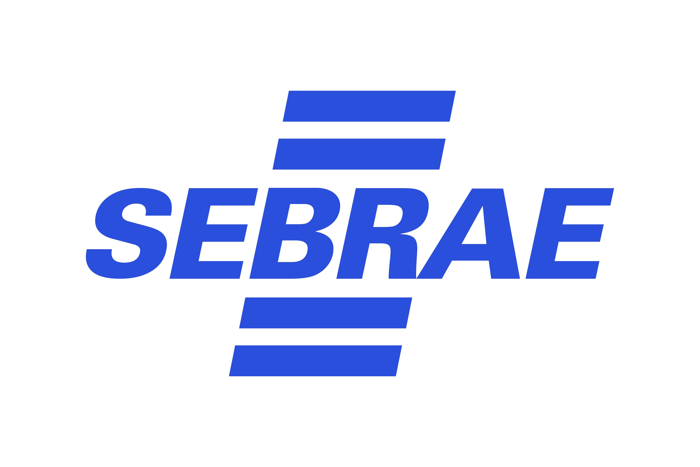
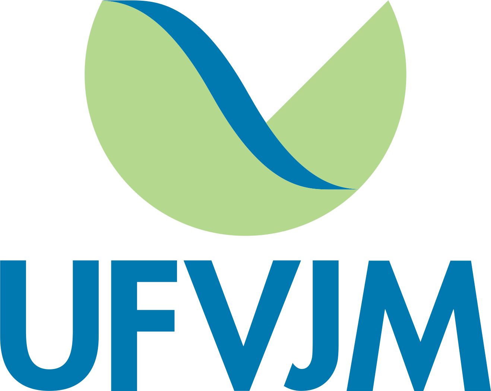

<tr>
<td valign="middle">
<h1>Olá, eu sou Gabriel Moraes!👋</h1>
</td>
<td valign="middle">
&nbsp;· Estudante de Sistemas de Informação na UFVJM (conclusão em 2027); 
&nbsp;· Gosto de ajudar pessoas a resolverem problemas com tecnologia; 
&nbsp;· Construindo minha base em desenvolvimento, dados e sistemas corporativos. 
&nbsp;· Diamantina, Minas Gerais, Brasil 
</td>
</tr>

 

<table width="100%">
<tr>
<td width="50%" valign="top">

### 🧑‍💻 Sobre mim

- 🤝 Dois anos de estágio no Sebrae Minas, com foco no atendimento aos empreendedores e suporte técnico a usuários na utilização de sistemas corporativos.
- 📊 Extração, tratamento e análise de dados no Salesforce, com relatórios e indicadores.
- ☕ Estudando e praticando desenvolvimento com Java e bancos de dados.
- 🌱 Estudando front-end.
- 🤖 Uso IA como apoio para estudar e depurar, sempre entendendo e validando o que é produzido.

</td>
<td width="50%" valign="top">

### 🛠️ Tecnologias

#### Linguagens

#### Frameworks

#### Bancos de dados

#### Ferramentas

</td>
</tr>
</table>

 

## 💼 Experiência Profissional

<table width="100%">
<tr>
<td width="50%" valign="top">

 
  
 <b>**SEBRAE Minas** · Estagiário</b> *11/2024 – 10/2026*</i>

- Consulta, extração, tratamento e análise de dados no **Salesforce**.
- Relatórios gerenciais e acompanhamento de indicadores para apoio à tomada de decisão.
- Suporte técnico e funcional aos usuários de sistemas corporativos.
- Organização de dados em planilhas, contribuindo para a confiabilidade das informações.
 
</td>
<td width="50%" valign="top">

 

 <b>**UFVJM** · Monitor de Lógica Computacional e Matemática Discreta · </b>*03/2024 – 10/2024*</i>

- Apoio a estudantes em lógica proposicional, conjuntos, análise combinatória e grafos.
- Organização e condução de sessões de estudo em grupo, promovendo a aprendizagem e a troca de conhecimentos.
- Desenvolvimento de didática e raciocínio analítico ao explicar conteúdos complexos de forma acessível.
- Elaboração e resolução orientada de exercícios práticos, reforçando a compreensão dos conteúdos e a aplicação dos conceitos estudados.

</td>
</tr>
</table>

 

## 🚀 Projetos em destaque

<table width="100%">
  <thead>
    <tr>
      <th width="25%">Projeto</th>
      <th width="50%">Descrição</th>
      <th width="25%">Tecnologias</th>
    </tr>
  </thead>
  <tbody>
    <tr>
      <td><a href="https://github.com/gbmoraes7/Sistema-de-Gerenciamento-de-Barbearia"><b>Sistema de Gerenciamento de Barbearia</b></a></td>
      <td>Sistema de gestão de agendamentos, cadastro de clientes e funcionários, vendas de mercadorias e geração de relatórios financeiros.</td>
      <td><code>Java</code> <code>Programação Orientada à Objeto</code> <code>Design Patterns</code></td>
    </tr>
  </tbody>
</table>
